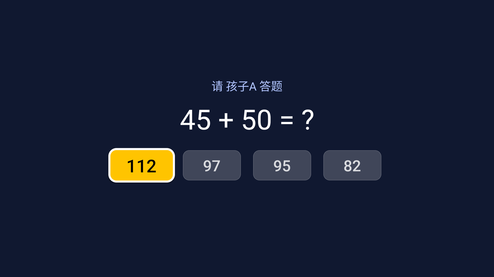
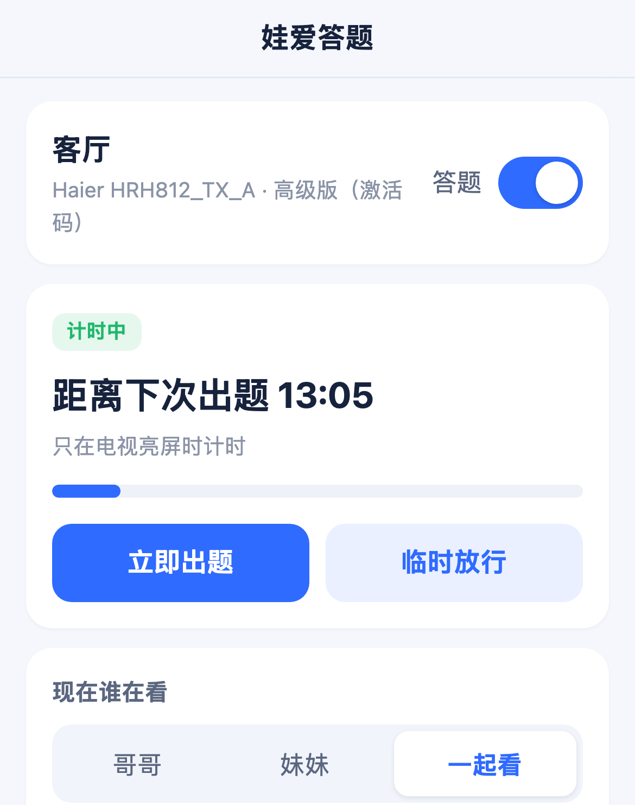
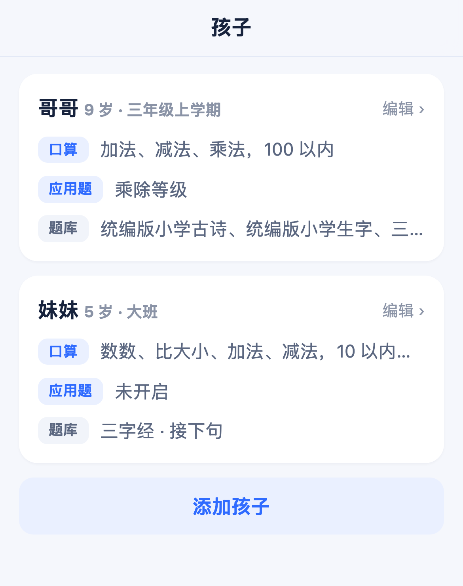
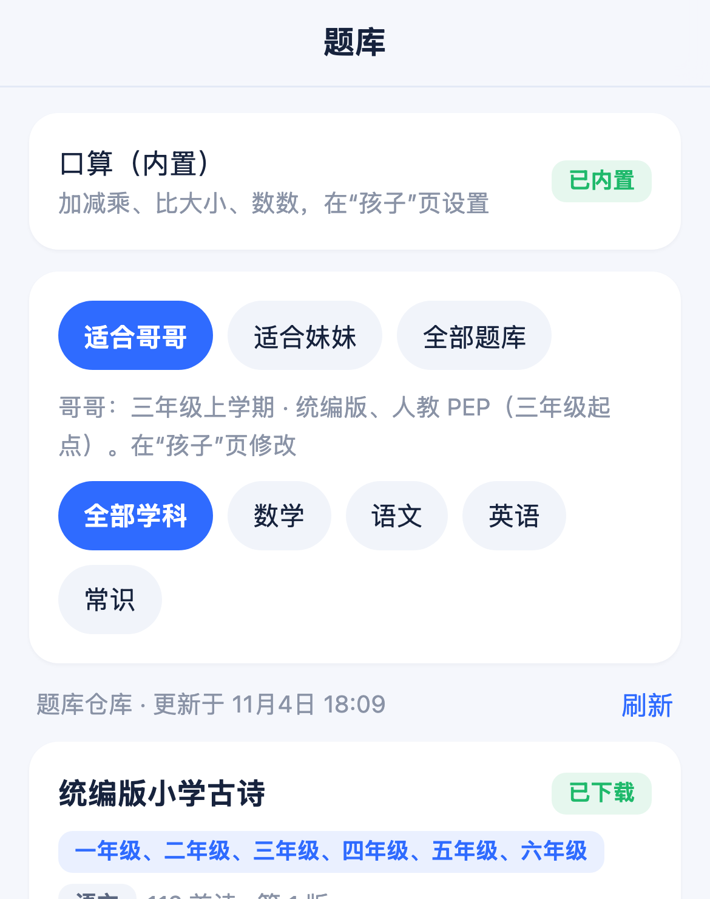
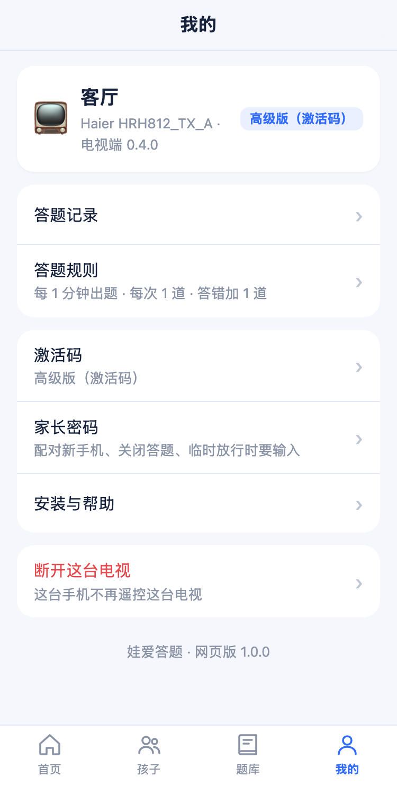

<div align="center">



# 娃爱答题 · LoveStudyOnTV

**先学习，再看电视。** 一款装在安卓电视上的儿童答题应用。

🌐 **官网：[http://106.54.222.166:8686/](http://106.54.222.166:8686/)**（下载、安装说明、常见问题）

电视每播放一段时间，弹出一道题。孩子答对了，才能接着看。

[](#系统要求)
[](http://106.54.222.166:8686/download/tvquiz.json)
[](#免费版和高级版)
[](LICENSE)

[下载电视端](http://106.54.222.166:8686/download/tvquiz.apk) ·
[安装方法](docs/install.md) ·
[让 AI 帮你装](docs/ai-install.md) ·
[官网](http://106.54.222.166:8686/) ·
[问题反馈](https://github.com/tv-quiz/LoveStudyOnTV/issues) ·
[English](README.en.md)

</div>

---

## 它能做什么

孩子看电视，很难自己停下来。「娃爱答题」把看电视和学习连起来：

- 电视每播放一段时间（家长设定，例如 15 分钟），全屏弹出一道题。
- 孩子用遥控器选答案。答对了，接着看；答错了，换一道新题，还可以多加几道。
- 题目按孩子的年级和学期出，只出学过的内容。
- 家长用手机管理。手机不用装应用，用相机扫电视上的二维码就行。

## 为什么选娃爱答题

| | |
|---|---|
| **日常不用电脑** | 手机相机扫码，浏览器里就能管理。改规则、看记录、加孩子，都在手机上。 |
| **按年级出题** | 统编版语文古诗、生字，按年级和学期出题。数学应用题分等级。英语单词按教材出题。 |
| **几个孩子一起看** | 三种方式：**各答一道**（每人答自己的题，都答对才继续）、**轮流答**、**按小的出**（按年龄小的孩子出题）。 |
| **口算永久免费** | 数数、比大小、加减乘。可以设数的范围、要不要进位借位。 |
| **家长密码** | 配对新手机、关闭答题、临时放行，都要 6 位家长密码。 |
| **只在亮屏时计时** | 电视关屏、待机时不计时。 |

## 截图

<div align="center">
<br>
<sub>电视上的口算题：用遥控器左右选择，按确认键作答</sub>
</div>

<div align="center">
<br>
<sub>电视首页：手机连同一个 Wi-Fi，用相机扫码</sub><br><br>



<br>
<sub>手机浏览器里管理：开关答题、临时放行、哥哥妹妹各出各的题、选题库、输入激活码</sub>
</div>

## 三步开始用

1. **把应用装到电视上。** 下载 [tvquiz.apk](http://106.54.222.166:8686/download/tvquiz.apk)，用 U 盘、电视浏览器或电脑 adb 安装。装好后，允许它「显示在其他应用上层」。详细步骤见 [安装方法](docs/install.md)。
2. **手机扫码。** 在电视上打开「娃爱答题」，首页有一个二维码。手机连上和电视相同的 Wi-Fi，用相机扫码，管理页面就打开了。
3. **配对，设密码。** 输入电视上的 6 位配对码，设置 6 位家长密码。然后添加孩子，选年级，定多久出一次题。

> 不会装？把 [AI 安装指南](docs/ai-install.md) 复制给能执行命令的 AI 助手，它会帮你装好。

## 下载

| 渠道 | 地址 |
|---|---|
| 最新版（直接下载） | http://106.54.222.166:8686/download/tvquiz.apk |
| 版本信息 | http://106.54.222.166:8686/download/tvquiz.json |
| GitHub Releases | [Releases](https://github.com/tv-quiz/LoveStudyOnTV/releases) |

安装包要装在**电视或电视盒子**上，不要装在手机上。

### 系统要求

- 安卓 9 及以上的智能电视或电视盒子。
- LG（webOS）、三星（Tizen）不是安卓系统，不能用。
- 手机：任何能扫码、能打开网页的手机。手机和电视要连同一个 Wi-Fi。

## 免费版和高级版

| 功能 | 免费版 | 高级版 |
|---|:---:|:---:|
| 内置口算题 | ✓ | ✓ |
| 家长密码、出题规则 | ✓ | ✓ |
| 今天的答题记录 | ✓ | ✓ |
| 孩子数量 | 1 个 | 多个，可以一起看 |
| 数学应用题 | | ✓ |
| 题库：古诗、生字、英语等 | | ✓ |
| 历史答题记录 | | ✓ |

**升级高级版：** 现在是内测期，激活码**免费**。到[官网](http://106.54.222.166:8686/#group)扫码进家长群领取，再在手机管理页面打开「我的 → 激活码」输入。

**更新电视端：** 有新版本时，手机管理页面的首页会提示。点「更新」，电视会自己下载，然后用遥控器在安装提示上选「安装」。设置和配对都会保留。0.4.2 以前的版本请先手动装一次新版本。

## 常见问题

<details>
<summary><b>手机要装应用吗？</b></summary>

不用。手机用相机扫电视上的二维码，在浏览器里管理。
</details>

<details>
<summary><b>扫码后打不开页面怎么办？</b></summary>

1. 确认手机和电视连的是同一个 Wi-Fi。
2. 关掉手机上的 VPN 或代理。
3. 电视换过网络或重启过路由器的话，回到电视首页，重新扫码。

更多办法见 [安装方法 · 故障排查](docs/install.md#故障排查)。
</details>

<details>
<summary><b>到时间了不弹题？</b></summary>

检查是否允许了「显示在其他应用上层」。电视设置里找不到这个菜单时，用电脑执行：

```
adb shell appops set com.gebilaozhongyi.tvquiz SYSTEM_ALERT_WINDOW allow
```

如果用了一段时间后不弹题，可能是电视的清理功能关掉了应用。请把「娃爱答题」加入白名单，允许自启动。
</details>

<details>
<summary><b>电视不让装外来应用？</b></summary>

有的品牌限制 U 盘或浏览器安装。这时用电脑 adb 安装，见 [安装方法](docs/install.md)。
</details>

<details>
<summary><b>源代码开放吗？</b></summary>

不开放。本仓库只发布安装包、使用说明和问题反馈。见 [LICENSE](LICENSE)。
</details>

<details>
<summary><b>会收集孩子的信息吗？</b></summary>

孩子的名字、年级、规则和答题记录保存在电视上。管理页面由电视在家里的局域网提供。
</details>

## 反馈和建议

- 遇到问题：[提交问题报告](https://github.com/tv-quiz/LoveStudyOnTV/issues/new?template=bug_report.md)
- 想要新功能或新题库：[提交功能建议](https://github.com/tv-quiz/LoveStudyOnTV/issues/new?template=feature_request.md)

提交问题时，请写上电视品牌、型号、应用版本，最好附一张照片或截图。

## 关键词

电视答题 · 先学习再看电视 · 儿童看电视管控 · 看电视前先答题 · 电视家长控制 · 口算 · 古诗 · 生字 · 小学数学应用题 · Android TV · 电视盒子 · kids quiz · screen time · parental control · learn before watching TV

---

<div align="center"><sub>娃爱答题 · 让孩子先答题，再看电视</sub></div>
